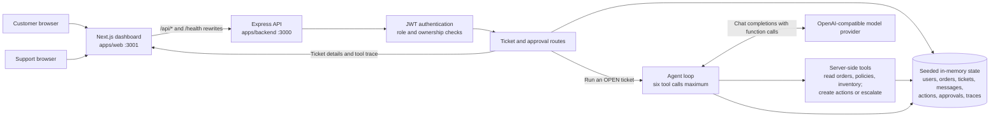
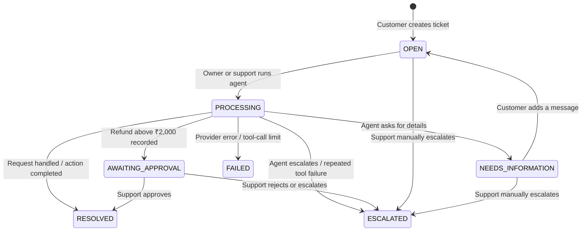

# Ticket Agent

Ticket Agent is a demo customer support system for order problems. Customers create tickets and run an AI agent that investigates orders, policies, and inventory through server-side tools. The agent can record a replacement or refund, ask for more information, or escalate to human support. Refunds above ₹2,000 enter a support approval workflow. A Next.js dashboard exposes the conversation, ticket status, and the agent's tool-call trace.

The application is a Bun workspace with two apps: an Express API and a Next.js web interface. Its data is seeded and held in memory, so it is suited to local development, demonstrations, and evaluation rather than persistent production use. A recorded refund or replacement is an in-memory action; this project does not connect to a payment processor or fulfillment service.

## Contents

- [Architecture](#architecture)
- [How a ticket moves through the system](#how-a-ticket-moves-through-the-system)
- [Requirements and quick start](#requirements-and-quick-start)
- [Configuration](#configuration)
- [Using the dashboard](#using-the-dashboard)
- [Business rules](#business-rules)
- [HTTP API](#http-api)
- [Agent and tools](#agent-and-tools)
- [Seed data](#seed-data)
- [Testing and checks](#testing-and-checks)
- [Docker](#docker)
- [Project layout](#project-layout)
- [Security and limitations](#security-and-limitations)
- [Troubleshooting](#troubleshooting)

## Architecture



The browser calls relative `/api/*` URLs. Next.js rewrites those requests to the backend using `BACKEND_URL`; the browser does not call the model provider. The Express routes authenticate the request and enforce role and ticket ownership. The model chooses from seven function definitions, while the backend executes those functions and records their results in shared state. Tool functions are not public HTTP endpoints.

The API is the source of truth for ticket status, messages, actions, and approvals. `apps/backend/src/state.ts` creates the seed data and exports the process-local `state` object. There is no database or queue. Restarting the backend restores its initial seed data and removes tickets created during the previous process lifetime.

## How a ticket moves through the system



Only `OPEN` tickets can start an agent run. A customer may add a message to an `OPEN` or `NEEDS_INFORMATION` ticket; in the latter case, the message returns the ticket to `OPEN`, ready for another explicit run. Agent runs are synchronous from the caller's perspective: the `/run` request waits for the model and tool loop to finish. The dashboard's **Run AI Agent** button starts that request; creating a ticket alone does not run the agent.

`RESOLVED`, `ESCALATED`, and `FAILED` are terminal in the current API. There is no route to reopen them. A high-value refund remains a pending action until support approves or rejects it. Manual escalation from `AWAITING_APPROVAL` rejects the pending action.

## Requirements and quick start

- [Bun](https://bun.com/docs/installation), matching the root `packageManager` declaration (`bun@1.3.13`) as closely as practical.
- An API key for a model provider that supports OpenAI-style chat-completion function calling. Ticket creation and browsing work without it; running the agent requires it.
- Ports **3000** (API) and **3001** (web) available, or an adjusted local configuration.

From the repository root, install dependencies and create the backend environment file:

```powershell
bun install
Copy-Item apps/backend/.env.example apps/backend/.env
```

On macOS or Linux, use `cp apps/backend/.env.example apps/backend/.env` for the second command. Edit `apps/backend/.env`: set a strong `JWT_SECRET` and configure one provider as described below. Then start the API and web app together:

```powershell
$env:BACKEND_URL = "http://localhost:3000"
bun run dev
```

Open [http://localhost:3001](http://localhost:3001). The API health endpoint is [http://localhost:3000/health](http://localhost:3000/health). In a POSIX shell, set the web proxy for the local API with `BACKEND_URL=http://localhost:3000 bun run dev`.

> **Why set `BACKEND_URL` locally?** `apps/web/next.config.mjs` defaults to `http://backend:3000`, the service name used by Docker Compose. Outside Docker, the backend is normally reached as `localhost:3000`.

The root scripts use Turborepo to run workspace scripts:

| Command | Effect |
| --- | --- |
| `bun run dev` | Run the backend in watch mode and the Next.js dev server. |
| `bun run start` | Start both apps without watch mode; the web app must already have a production build. |
| `bun run test` | Run workspace test scripts; the backend tests call a real model provider. |
| `bun run check` | Run workspace checks. |

To run the apps separately, start `bun run dev` inside `apps/backend` and `bun run dev` inside `apps/web` in different terminals. Set `BACKEND_URL=http://localhost:3000` in the web terminal. For a production-style local web build, run `bun run build` in `apps/web` before its `bun run start` command.

## Configuration

The backend reads `apps/backend/.env` when started with Bun. The sample is in [`apps/backend/.env.example`](apps/backend/.env.example). Never commit the populated `.env` file.

| Variable | Used by | Purpose |
| --- | --- | --- |
| `PORT` | Backend | API listener port; defaults to `3000`. |
| `HOST` | Backend | Listener address; defaults to `0.0.0.0`. |
| `JWT_SECRET` | Backend | Signs and verifies 24-hour login tokens; required for login. |
| `OPENROUTER_API_KEY` | Backend | Selects OpenRouter when present. |
| `OPENROUTER_MODEL` | Backend | OpenRouter model; code defaults to `google/gemini-2.5-flash`. |
| `AI_API_KEY` | Backend | Selects a general OpenAI-compatible provider when present. |
| `AI_MODEL` | Backend | Model for `AI_API_KEY`; code defaults to `gpt-4o-mini`. |
| `AI_BASE_URL` | Backend | Optional base URL for the general compatible provider. |
| `OPENAI_API_KEY` | Backend | Selects direct OpenAI when present. |
| `OPENAI_MODEL` | Backend | Direct OpenAI model; code defaults to `gpt-4o-mini`. |
| `BACKEND_URL` | Web server | Target for Next.js `/api/*` and `/health` rewrites. Set to `http://localhost:3000` for local development; Compose sets `http://backend:3000`. |

Provider selection follows this order: `OPENROUTER_API_KEY`, then `AI_API_KEY`, then `OPENAI_API_KEY`. Configure one path to avoid ambiguity. For example:

```dotenv
PORT=3000
JWT_SECRET=replace-with-a-long-random-secret
OPENROUTER_API_KEY=your-key
OPENROUTER_MODEL=google/gemini-2.5-flash
```

Or use a compatible provider:

```dotenv
JWT_SECRET=replace-with-a-long-random-secret
AI_API_KEY=your-key
AI_MODEL=your-tool-capable-model
AI_BASE_URL=https://your-provider.example/v1
```

The selected model must support function/tool calls through the chat-completions API. The application makes real provider requests when an agent run starts; these may incur provider charges or rate limits.

## Using the dashboard

1. Open `http://localhost:3001`. On a fresh browser session the demo attempts to log in as Customer 1 automatically. You can switch accounts through the login interface.
2. As a customer, select **New Ticket** and choose a preset scenario or enter an order ID, subject, and message. An order ID is optional, but if supplied it must belong to that customer.
3. Open the ticket and select **Run AI Agent**. The agent may consult order, policy, and inventory tools, then update the ticket. Open the **Agent Tool Execution Trace** tab to inspect each recorded call and its arguments, result, or error.
4. If the ticket says `NEEDS_INFORMATION`, send the requested detail in the conversation and run the agent again when the ticket returns to `OPEN`.
5. Sign in as support to see all tickets, decide a pending refund approval, or manually escalate an eligible ticket.

The **System Reference** drawer displays the demo's seeded orders, product prices, starting stock, and policies. It is a reference panel with hard-coded display values; it does not query current inventory after actions change stock.

The seeded demo accounts all use `password123`:

| Role | Email | Typical use |
| --- | --- | --- |
| Customer 1 | `customer1@s30.test` | Keyboard and headphones scenarios. |
| Customer 2 | `customer2@s30.test` | Separate customer data and out-of-stock mouse scenario. |
| Support | `support@s30.test` | View all tickets, approve or reject pending refunds, escalate. |

The dashboard stores the JWT and user profile in browser `localStorage`. Logging out clears both values. These accounts and the automatic Customer 1 login are demo conveniences; remove them before exposing the app to real users.

## Business rules

The server enforces these rules inside the tool implementations, even if the model requests an invalid action:

| Operation | Conditions | Result |
| --- | --- | --- |
| Read an order | Order must belong to the ticket's customer. | Returns order and product data. |
| Replacement | Delivered within the past 7 days; stock above zero; no conflicting action for the order. | Records a completed replacement and reduces stock by exactly one. |
| Refund | Delivered within the past 30 days; no conflicting action for the order. | Records a refund action for the product price. |
| Refund of ₹2,000 or less | Refund conditions above. | Action completes and the agent can resolve the ticket. |
| Refund above ₹2,000 | Refund conditions above. | Action is `PENDING`; ticket becomes `AWAITING_APPROVAL`. |
| Support approval | Pending action on an awaiting ticket. | Marks the action `COMPLETED` and ticket `RESOLVED`. |
| Support rejection | Pending action on an awaiting ticket. | Marks the action `REJECTED` and ticket `ESCALATED`. |

The seeded policy says an order may receive only one refund or replacement. For a pending or completed action, repeating the same type from the same ticket returns the existing action instead of repeating side effects; another ticket or action type is rejected. The current implementation permits a new action of the same type after a prior action was `REJECTED`, while still rejecting a different type. Checks and in-memory mutations in the action tools are synchronous, with no `await` between the final check and update.

## HTTP API

All routes return JSON. Successful responses use `{ "success": true, "data": ... }`; failures use `{ "success": false, "error": { "code": "...", "message": "..." } }`. Protected routes require `Authorization: Bearer <token>`. Customers can access their own tickets; support can read all tickets and run the agent on any `OPEN` ticket.

| Method | Path | Access | Main behavior |
| --- | --- | --- | --- |
| `GET` | `/health` | Public | Returns `{ "status": "ok" }`. |
| `POST` | `/api/auth/login` | Public | Exchange email and password for a 24-hour JWT and public user profile. |
| `POST` | `/api/tickets` | Customer | Create an `OPEN` ticket and its first customer message. |
| `GET` | `/api/tickets` | Customer / support | List tickets, newest first; optional `?status=OPEN` filter. |
| `GET` | `/api/tickets/:ticketId` | Owner / support | Read ticket, messages, tool calls, and pending action. |
| `POST` | `/api/tickets/:ticketId/messages` | Owner | Add a customer message to an `OPEN` or `NEEDS_INFORMATION` ticket. |
| `POST` | `/api/tickets/:ticketId/run` | Owner / support | Run the model and tools for an `OPEN` ticket. |
| `POST` | `/api/tickets/:ticketId/approval` | Support | Approve or reject an awaiting action. |
| `POST` | `/api/tickets/:ticketId/escalate` | Support | Manually escalate an eligible ticket. |

### Request bodies and responses

**Login** sends an email and password. The response contains `data.token` and `data.user`:

```json
{ "email": "customer1@s30.test", "password": "password123" }
```

**Create a ticket** accepts an optional `orderId`, a subject of 5–120 characters, and a message of 10–2000 characters. It returns the new ticket summary with HTTP `201`:

```json
{
  "orderId": "ORD-1001",
  "subject": "Keyboard arrived damaged",
  "message": "The keyboard has broken keys. Please replace it."
}
```

**List tickets** accepts any of the statuses shown in the state diagram as its `status` query value. The response is `data.tickets`. **Get ticket** returns `data.ticket`, `data.messages`, `data.toolCalls`, and `data.pendingAction` (or `null`). Messages and tool calls are returned in chronological/sequence order.

**Add a message** sends `{ "content": "The order number is ORD-1001." }`. Content is trimmed and must be 1–2000 characters. The `201` response includes `data.message` and `data.ticketStatus`.

**Run the agent** needs no request body. A successful response includes `ticketId`, `status`, `finalResponse`, `toolCallCount`, and `pendingAction`. A high-value refund can return a pending action like this:

```json
{
  "success": true,
  "data": {
    "ticketId": "TKT-...",
    "status": "AWAITING_APPROVAL",
    "finalResponse": "Your refund request is awaiting support approval.",
    "toolCallCount": 3,
    "pendingAction": {
      "id": "ACT-...",
      "type": "REFUND",
      "status": "PENDING",
      "amount": 4999
    }
  }
}
```

The response text and tool-call count above are illustrative: they depend on the model's choices. The action and status follow backend rules.

**Decide approval** sends `{ "decision": "APPROVED", "note": "Checked by support." }` or uses `REJECTED`. `note` is optional and at most 500 characters. The response includes the resulting ticket status and action. **Manual escalation** sends `{ "reason": "Issue requires manual review." }`; the trimmed reason must be 10–500 characters.

Common HTTP outcomes are `400` for invalid input, `401` for missing or invalid authentication, `403` for forbidden access, `404` for missing resources, `409` for invalid ticket state or concurrent processing, `500` for an agent tool-call limit failure, and `502` for a model provider failure. The code and message in `error` give the specific reason.

### Minimal API walkthrough

These commands use a POSIX shell and call the backend directly. In PowerShell, use `Invoke-RestMethod` with the same paths, JSON bodies, and bearer header.

```sh
TOKEN=$(curl -s http://localhost:3000/api/auth/login \
  -H 'Content-Type: application/json' \
  -d '{"email":"customer1@s30.test","password":"password123"}' \
  | jq -r '.data.token')

curl -s http://localhost:3000/api/tickets \
  -H "Authorization: Bearer $TOKEN"

curl -s http://localhost:3000/api/tickets \
  -H "Authorization: Bearer $TOKEN" \
  -H 'Content-Type: application/json' \
  -d '{"orderId":"ORD-1001","subject":"Keyboard arrived damaged","message":"The keyboard has broken keys. Please replace it."}'
```

The API example requires `curl` and `jq`. The final request creates a ticket; use the returned `data.id` with `POST /api/tickets/:ticketId/run` to start the agent.

## Agent and tools

`apps/backend/src/agent/agent.ts` assembles a system instruction and the ticket's customer/agent message history, then calls the configured provider's chat-completions API. It passes the function definitions from `apps/backend/src/tools/definitions.ts`. After each model response, it executes requested functions on the server, stores each tool call's sequence number, arguments, success/result or failure/error, and supplies the result back to the model. The loop ends when the model returns text, escalates, or reaches a failure condition.

| Tool | Purpose |
| --- | --- |
| `getOrder({ orderId })` | Read one customer-owned order and its product. |
| `getCustomerOrders({})` | List orders belonging to the ticket's customer. |
| `searchPolicies({ query })` | Search seeded policy text. |
| `checkInventory({ productId })` | Read a product's current stock. |
| `createReplacement({ orderId, reason })` | Validate and record a replacement; decrement stock. |
| `createRefundRequest({ orderId, reason })` | Validate and record a completed or approval-pending refund. |
| `escalateToHuman({ reason })` | Escalate the ticket with a reason. |

At most six function calls may execute in a run; failed calls count. If the same tool and arguments fail twice, the agent escalates. `state.activeRuns` prevents two simultaneous runs of the same ticket, and cleanup removes the ticket from that set when a run ends. The provider call has retry handling for rate limits and other provider errors. A failure during a provider request leaves the ticket `FAILED` and the API returns `502 MODEL_PROVIDER_ERROR`; exceeding the tool-call ceiling leaves it `FAILED` and returns `500 AGENT_STEP_LIMIT_EXCEEDED`. A run's final response is also stored as an agent message. A missing provider key also returns `502`, but currently leaves the ticket `PROCESSING` because configuration is checked after that status is set.

The agent can ask for missing information. It recognizes a `NEEDS_INFO:` prefix from the model and also detects certain order questions when the ticket has no associated order. Because the model chooses which tools to call and writes the response, exact wording and read-only tool order can vary.

## Seed data

`apps/backend/src/state.ts` creates three users, three products, five orders, inventory, and policies when the backend starts. The delivery dates below are relative to startup time.

| Product ID | Product | Price | Starting stock |
| --- | --- | ---: | ---: |
| `PROD-KEYBOARD` | Mechanical Keyboard | ₹1,500 | 10 |
| `PROD-HEADPHONES` | Wireless Headphones | ₹4,999 | 5 |
| `PROD-MOUSE` | Wireless Mouse | ₹999 | 0 |

| Order ID | Owner | Product | Seeded state |
| --- | --- | --- | --- |
| `ORD-1001` | Customer 1 | Keyboard | Delivered 3 days ago. |
| `ORD-1002` | Customer 1 | Headphones | Delivered 5 days ago. |
| `ORD-1003` | Customer 2 | Mouse | Delivered 2 days ago; replacement stock is zero. |
| `ORD-OLD-1` | Customer 1 | Keyboard | Delivered 45 days ago; outside refund and replacement windows. |
| `ORD-SHIPPED-1` | Customer 1 | Keyboard | Shipped, not delivered. |

The seeded policies cover replacements within 7 days with stock, refunds within 30 days with support approval above ₹2,000, and the one-action-per-order rule. Orders, tickets, messages, runs, tool calls, actions, and approvals all live in the same process-local state object. Generated IDs use prefixes such as `TKT-`, `MSG-`, `RUN-`, `TC-`, `ACT-`, and `APR-`.

## Testing and checks

Run backend tests from `apps/backend` after creating its `.env` file and configuring a real tool-capable model:

```powershell
Set-Location apps/backend
bun test
```

The evaluator tests start a backend process, call documented HTTP routes, and verify ownership, ticket outcomes, action side effects, and stored tool traces. Model scenarios make real provider calls; they are not offline unit tests. The test runner uses guarded `/__test/reset` and `/__test/state` endpoints to inspect and restore seed state. Those routes return `404` unless `NODE_ENV=test` and the evaluator token are both present. See [`apps/backend/test/README.md`](apps/backend/test/README.md) for evaluator setup and timing details.

For static checks from the repository root, use `bun run check`. For a web production build, run `bun run build` inside `apps/web`. These checks do not replace the real-provider backend tests.

## Docker

The root [`docker-compose.yml`](docker-compose.yml) defines the API on host port `3000` and the web app on host port `3001`. The web container proxies `/api/*` and `/health` to `http://backend:3000` inside the Compose network. The web service waits for the backend health check.

Create and configure `apps/backend/.env` first, then run from the repository root:

```powershell
docker compose up --build
```

Open [http://localhost:3001](http://localhost:3001). `docker compose down` stops the services. Because state is in memory, recreating or restarting the backend container resets tickets and actions. The backend also has a separate Compose file at `apps/backend/docker-compose.yml` for running only the API from that directory.

Both app Dockerfiles install from their app directories. The backend Dockerfile copies `apps/backend/.env` into its image, so that file must exist before building; review this packaging choice before distributing an image. The Compose service also supplies the same file via `env_file` at runtime.

## Project layout

```text
.
├── apps/
│   ├── backend/
│   │   ├── .env.example          # Provider and JWT template
│   │   ├── src/
│   │   │   ├── index.ts          # Express server, health, evaluator routes
│   │   │   ├── state.ts          # Types and seeded in-memory state
│   │   │   ├── agent/agent.ts    # Model/tool loop and run lifecycle
│   │   │   ├── tools/definitions.ts # Function schemas and implementations
│   │   │   ├── middleware/auth.ts   # JWT and role checks
│   │   │   └── routes/          # Login and ticket HTTP routes
│   │   └── test/                # Black-box API/evaluator tests
│   └── web/
│       ├── app/                 # Next.js page, layout, styles
│       ├── components/          # Dashboard and workflow UI
│       ├── lib/api.ts           # Browser API client and token storage
│       └── next.config.mjs      # Backend rewrites
├── docker-compose.yml          # API + web deployment
├── package.json                # Bun workspace commands
├── turbo.json                  # Task orchestration
└── bun.lock                    # Dependency lockfile
```

The existing [`apps/backend/README.md`](apps/backend/README.md) describes the original backend assignment and response contract. This root README describes the integrated repository as currently implemented, including the web dashboard and Docker setup.

## Security and limitations

- Demo users, passwords, orders, policies, and inventory are seeded in source. The dashboard automatically signs in as Customer 1 when no stored session exists.
- The browser stores its JWT in `localStorage`; the API verifies it on protected routes. Customer ownership is checked when tickets are created/read and when tools read or mutate orders. Support-only approval and escalation routes enforce the `SUPPORT` role.
- All application state is process-local and disappears on restart. Running multiple backend replicas would give each replica independent tickets and stock; the current run lock and action idempotency apply within one process.
- Refunds and replacements are in-memory records only. There is no external payment, shipment, email, or notification integration.
- The current action checks allow a new action of the same type after an earlier one was rejected, despite the seeded policy's one-action wording.
- The web **System Reference** inventory values are static UI reference data. Use the agent's inventory tool or the test-only state endpoint in tests to observe changed stock.
- The current backend Dockerfile includes `.env` in the image build context and copies it into the image. Do not publish an image built with real secrets without changing that approach.

## Troubleshooting

| Symptom | Check |
| --- | --- |
| Dashboard cannot reach the API | Confirm the backend is on port `3000` and `BACKEND_URL=http://localhost:3000` is set for local web development. In Docker, use the Compose-provided service URL. |
| Login returns an internal error | Set `JWT_SECRET` in `apps/backend/.env` and restart the backend. |
| Agent run returns `502 MODEL_PROVIDER_ERROR` | Configure one valid provider key and a tool-capable model; inspect backend logs for provider and rate-limit details. Provider request failures mark the ticket `FAILED`. With no key configured, the current code leaves it `PROCESSING`; restart the demo backend after configuring a key. |
| Agent run returns `409 INVALID_TICKET_STATE` | Only `OPEN` tickets can run. Reply to a `NEEDS_INFORMATION` ticket first; terminal tickets cannot be rerun. |
| Agent run returns `500 AGENT_STEP_LIMIT_EXCEEDED` | The model requested more than six tool calls in one run. Inspect the stored tool trace and prompt/model behavior. |
| A replacement or refund is rejected | Check delivery age and status, customer ownership, stock for replacements, and whether that order already has an action. |
| Tickets disappeared after restart | Data is held only in backend memory. Restarting the process or container restores the original seed state. |
